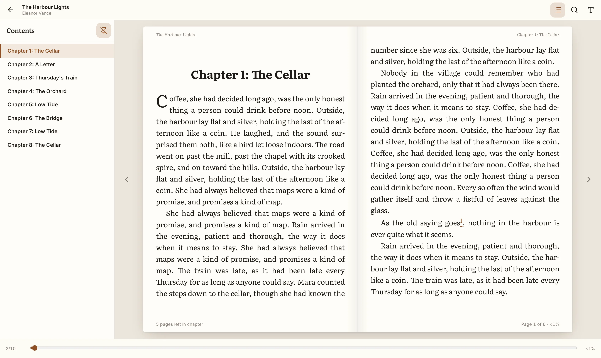
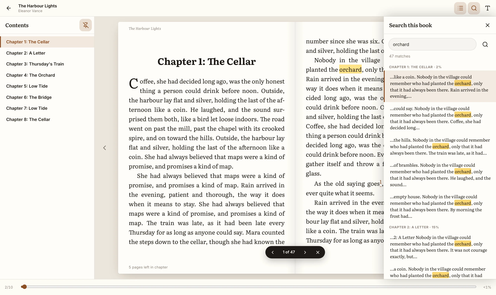
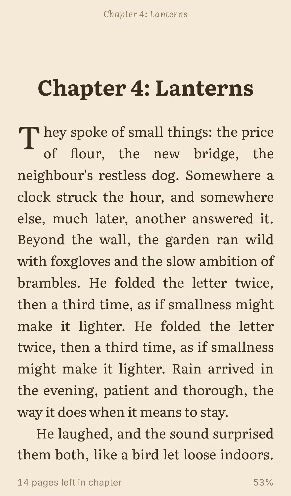
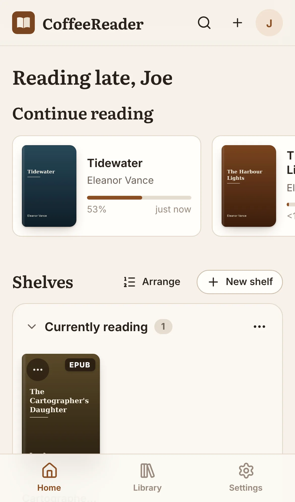

# CoffeeReader

A self-hosted ebook library and reader that puts **readability** first. Books look and turn like
pages in a book, not like web pages. Organise them on shelves by dragging and dropping, read on your
phone with taps and swipes, and keep everything in one container with two volumes.


| Reading on a wide screen | Search inside a book |
| --- | --- |
|  |  |

| Phone reader | Phone library |
| --- | --- |
|  |  |

## What it does differently

| Pain point | CoffeeReader |
| --- | --- |
| Pages render as plain HTML with no page structure | Chapters are laid out as real **pages**: margins, running heads, page numbers, "pages left in chapter", a two-page spread on wide screens, and themes (Paper, Sepia, Dusk, Night) with comfortable line lengths. |
| Turning pages needs small buttons or side areas | **Click or tap** the right side for the next page, the left for the previous one. **Swipe** on touch screens (the page follows your finger), **scroll** with a mouse wheel or trackpad (one flick, one page), or use the **keyboard**. |
| Table of contents is hidden in a menu | The contents can be **pinned open beside the page** on larger screens and always highlights where you are. On phones it's one tap away. |
| No search | **Full-text search inside a book**: results grouped by chapter with snippets; tap one to jump to the page with the words highlighted, then step through matches. Plus library search by title, author or series. |
| Home page shows books in a single ungrouped row | The home page shows **Continue reading**, then **every shelf as a section of covers**. Drag books between shelves, reorder them, or drag shelves into order. The Library page sorts, filters and groups by **series** or **author**. |

Also:

- **Upload from the browser.** Click **Add books** or drop files anywhere on the page. Uploads go to
  the books folder, so the folder stays the source of truth.
- **Or just drop files in the folder.** New, moved and renamed files are noticed automatically.
  Moving or renaming a file keeps its reading progress and shelf places, because books are
  recognised by content.
- **Organisation lives in the database**: shelves, edited metadata and reading progress never touch
  your files.
- **Multiple people.** Everyone shares the library and has their own shelves and progress.
  Administrators manage people, edit book details and delete books.
- **Progress syncs** between devices. Opening a book anywhere resumes at the same sentence, even if
  the other device uses a different text size.
- **Installable** on phones as a home-screen app (PWA) for full-screen reading.

Supported format: **EPUB** (2 and 3).

## Quick start (Docker)

```bash
git clone https://github.com/CoffeeRoll/CoffeeReader.git && cd CoffeeReader
```

```bash
mkdir -p books config
```

```bash
docker compose up -d --build
```

Open <http://localhost:8080> and create the administrator account. Then add books by uploading them,
or by copying `.epub` files into `./books` (any folder structure works).

The compose file builds the image from source. Once CI has published an image (it builds one for
amd64 and arm64 on every push to `main`), you can skip the clone: copy `docker-compose.yml` anywhere,
delete its `build: .` line and set `image: ghcr.io/coffeeroll/coffeereader:latest`.

### Volumes

| Path in container | What it holds |
| --- | --- |
| `/books` | Your ebooks. Uploads are saved to `/books/Uploads`. Can be mounted read-only (`:ro`); reading still works, but uploads and deleting are disabled. |
| `/config` | The SQLite database (shelves, progress, users, metadata edits), cover thumbnails and the keys that keep you signed in across restarts. **Back this up.** |

### Permissions

The container runs as a non-root user. Set `PUID`/`PGID` to the owner of your `books` and `config`
folders (find them with `id -u` and `id -g`):

```bash
PUID=1000 PGID=1000 docker compose up -d
```

If `/config` isn't writable, the container stops with a message saying so.

### Configuration

Settings are environment variables (double underscores separate sections).

| Variable | Default | Description |
| --- | --- | --- |
| `LibraryScan__IntervalMinutes` | `60` | Full rescan interval, a fallback for file systems that don't report changes (some network shares). `0` turns it off. |
| `LibraryScan__WatchForChanges` | `true` | React to files being added, moved or removed. |
| `LibraryScan__ScanOnStartup` | `true` | Scan the library when the app starts. |
| `Uploads__MaxFileSizeMb` | `512` | Largest file accepted by uploads. |
| `Storage__UploadFolder` | `Uploads` | Folder inside `/books` that uploads are written to. |
| `ReverseProxy__TrustForwardedHeaders` | `false` | Set to `true` behind a reverse proxy so client IPs and HTTPS are detected correctly. |
| `ASPNETCORE_HTTP_PORTS` | `8080` | Port the app listens on inside the container. |

### Reverse proxy

CoffeeReader is a single origin (the app and API share it), so any reverse proxy works with a plain
pass-through. Set `ReverseProxy__TrustForwardedHeaders=true` and raise the proxy's request size
limit to allow uploads (for example `client_max_body_size 512m;` in nginx). Caddy example:

```
books.example.com {
    reverse_proxy coffeereader:8080
}
```

The health check endpoint is `GET /health`.

## Reading controls

| Action | Mouse & keyboard | Touch |
| --- | --- | --- |
| Next page | Click anywhere but the left edge, scroll down, `→` `↓` `Space` `PageDown`, or the `›` arrow | Tap the right side, or swipe left |
| Previous page | Click the left 30% of the page, scroll up, `←` `↑` `Shift+Space` `PageUp`, or the `‹` arrow | Tap the left side, or swipe right |
| Show or hide toolbars | Always shown | Tap the middle of the page |
| Contents | `T`, or the list button (pin it to keep it open) | List button |
| Search | `/`, or the magnifier | Magnifier |
| Text, theme, margins, layout | The **Aa** button | The **Aa** button |

Following a link in a book (for example a footnote) shows a **Back to where you were** button.
Reading settings are saved per device, since a phone and a monitor usually want different sizes.

## Architecture

```
src/
  CoffeeReader.Domain          Entities and rules (books, shelves, progress, users). No dependencies.
  CoffeeReader.Application     Use cases and ports: auth, users, catalog, reader, search, shelves,
                               library import/scan. Depends only on Domain (+ EF Core abstractions).
  CoffeeReader.Infrastructure  Adapters: EF Core + SQLite, EPUB parser and sanitizing chapter
                               renderer, library folder, cover thumbnails, background scanner.
  CoffeeReader.Api             ASP.NET Core host: cookie sessions, minimal API endpoints,
                               security headers, serves the web app.
web/                           React + TypeScript (Vite)
  src/api                      Typed API client and TanStack Query hooks
  src/features/library         Home (shelf board), library grid, book page, shelf actions
  src/features/reader          Paginator engine, reader UI, panels, search folding
  src/features/settings        Account, people and library administration
tests/CoffeeReader.Tests       Domain, parser, sanitizer, search and full API flow tests
```

How the main pieces work:

- **Library scanning.** The books folder is the source of truth for *which* books exist. Each file
  is identified by its SHA-256 hash, so a moved or renamed file keeps its identity and a copy of an
  existing book is reported instead of imported twice. A file-system watcher, a periodic scan and
  an on-demand scan all feed one background queue, and imports never run concurrently.
- **Reading.** The server parses each chapter (tolerating the sloppy XHTML found in real EPUBs),
  strips anything executable with an allow-list sanitizer, and returns the body and stylesheets.
  The browser renders it in a same-origin iframe laid out with CSS multi-column: one column per page,
  or two for a spread. Page turns are GPU transforms. Positions are stored as a character offset
  into the chapter, which is why reflowing text keeps you on the same sentence.
- **Search.** The server scans the chapters and returns the *n*-th match per chapter. The browser
  folds text with the same rules (case, accents, whitespace) to find and highlight that exact
  occurrence.
- **Security.** Passwords use ASP.NET Core Identity's PBKDF2 hasher. Sessions are HttpOnly,
  SameSite=Strict cookies tied to a security stamp that is re-checked every 30 seconds, so changing
  a password or removing a user signs them out everywhere. State-changing API calls also require a custom
  header. A strict Content-Security-Policy (inherited by the reader iframe) means book content can
  never run scripts, and files served out of books are sandboxed. Logins are rate limited.

## Development

Requirements: .NET 10 SDK and Node.js 22.

```bash
dotnet run --project src/CoffeeReader.Api
```

```bash
cd web && npm install && npm run dev
```

The API listens on <http://localhost:5200> and stores data in `.dev/books` and `.dev/config`. Vite
serves the app on <http://localhost:5173> and proxies `/api` to the API.

Tests:

```bash
dotnet test
```

```bash
cd web && npm run typecheck && npm test
```

Database migrations live in `src/CoffeeReader.Infrastructure/Persistence/Migrations` and are applied
automatically at startup. To add one after changing the model:

```bash
dotnet tool restore
```

```bash
dotnet ef migrations add <Name> --project src/CoffeeReader.Infrastructure --startup-project src/CoffeeReader.Api --output-dir Persistence/Migrations
```

Build the container image locally:

```bash
docker build -t coffeereader .
```

## Limitations and ideas

- EPUB only for now; PDF and comic archives (CBZ) aren't supported.
- No bookmarks, highlights or notes yet.
- No OPDS feed for third-party reader apps.
- Reading needs a connection to the server; there's no offline mode.

## License

Apache 2.0. See [LICENSE](LICENSE).
